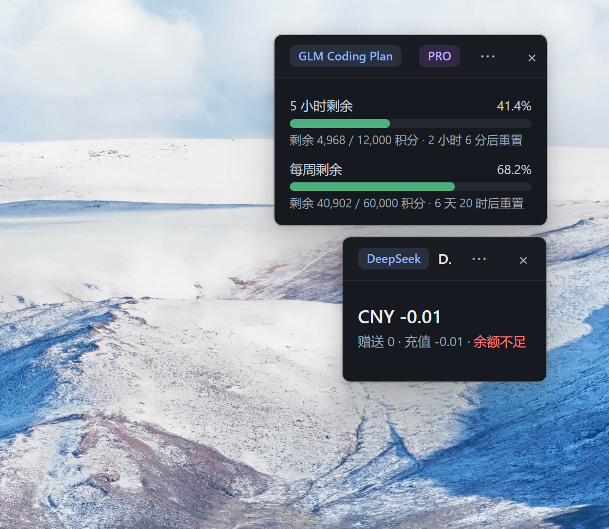

[English](./README.md) | [简体中文](./README.zh-cn.md)

# Token Balance



A lightweight **Tauri 2** desktop widget that lives in your system tray and shows LLM API balance / quota at a glance — one tiny always-on-top window per connection.

## Features

- **Multi-provider, per-connection windows** — each connection gets its own borderless, semi-transparent mini window (DeepSeek wallet balance, GLM Coding Plan quota bars). No main window; everything is driven from the tray.
- **System tray menu**
  - *Refresh all* — force-refresh every connection
  - *Add connection* — validate the API key live before saving
  - *Connections list* — checkmark = window visible; click to toggle
  - *Quit*
- **Auto refresh** every 30s per connection, with exponential backoff (up to 15 min) on errors; last-refresh time shown in the refresh button tooltip
- **Providers**
  - **DeepSeek** — prepaid wallet: total / granted / topped-up balance (official `/user/balance` endpoint)
  - **GLM Coding Plan** — remaining credits as reversed progress bars for the rolling 5-hour window and weekly window, with reset countdown and plan tier badge (community-discovered `GET /api/monitor/usage/quota/limit` endpoint — unofficial, may break on Zhipu side)
- **Window niceties**
  - Position is remembered and validated on startup; invalid positions (monitor unplugged, resolution changed) fall back to a right-aligned vertical stack at the top-right corner
  - Per-window opacity slider (30–100%, persisted)
  - Refresh / delete tucked into a `⋯` dropdown; delete requires a confirm click
  - Drag anywhere (except buttons/inputs); no scrollbars

## Getting Started

Prerequisites: Node.js LTS, Rust (MSVC toolchain on Windows), WebView2 (preinstalled on Win10/11).

```bash
npm install
npm run tauri dev      # development
npm run tauri build    # production build (exe + MSI/NSIS installers)
```

Add your first connection from the tray menu → *添加连接* (Add connection): pick a provider, paste the API key, save. Keys are stored in plain-text JSON locally — fine for a personal tool.

Config lives in `%APPDATA%\com.tokenbalance.app\`:
- `config.json` — connections (provider, name, API key, base URL)
- `positions.json` — remembered window positions

## Adding a Provider

1. Create `src/providers/<name>.ts` implementing the `TokenProvider` interface (`fetchBalance` returns a `wallet` or `quota` balance).
2. Register it in `src/providers/registry.ts`.
3. If the API host is new, add it to the `http:default` URL whitelist in `src-tauri/capabilities/default.json`.

See [AGENTS.md](./AGENTS.md) for development details.
